# Configuration effects (off / on)

Every switch and configuration key below only *does* something after it is switched on — this page
shows what that something looks like, captured on a real Windows machine (not mocked, not drawn by
hand), with the still pair and an animated GIF of the transition.

**How these images are produced** (fully re-runnable pipeline, `kode todo C-24` pattern):

```bash
# 1. on Windows — writes config.json/widgets.json, restarts the build, PrintWindow-captures the surfaces
powershell -NoProfile -ExecutionPolicy Bypass -File tools/doc-gif/capture-config-effects.ps1 `
    -Publish <path\to\Beacon.App.exe> -OutDir <frames-dir>
# 2. anywhere — builds the GIFs and the stills next to them
python tools/doc-gif/assemble.py <frames-dir> docs/img/config-effects
```

Captures are **window-level** (`PrintWindow(PW_RENDERFULLCONTENT)`): the screenshot shows the live
window content itself, so the pipeline works whether or not the console session happens to be
unlocked, on another virtual desktop, or showing a screen saver.

## Switch summary

| Key | File / section | Off | On | Takes effect |
|---|---|---|---|---|
| `theme` | config.json → `theme` | `light` | `dark` | Restart (WinUI theme is fixed at process start) |
| `pinDisplayMode` | config.json → `pinDisplayMode` | `panel` (one L0 host window) | `floating` (one window per widget) | Restart |
| `appearance.progressStyle` | config.json → `appearance` | `pool` (legacy circular fill) | `bar` (4 DIP bar + NN% readout) | Live |
| `appearance.motion.mode` | config.json → `appearance.motion` | `off` (everything still) | `full` (breathing/pulse animation) | Live |
| `appearance.density` | config.json → `appearance` | `regular` | `spacious` (spacing ×1.25) | Next render of each surface |
| `appearance.severityColors.warning` | config.json → `appearance` | `#d29922` (default amber) | `#ff00ff` (custom) | Live — tray, capsule, L0 all follow |
| `uiOpacity` | config.json | `1.0` | `0.5` | Live |
| `capsuleIsland` | config.json | `false` (capsule bottom-right) | `true` (island top-centre) | Live |
| `colorOverride` (per widget) | widgets.json | absent (follows the palette) | `#00e5ff` (widget wins over palette) | Live |

> `launchOnStartup`, `hotkey`, `pollIntervalSeconds`, `keepQuickPanelOpen` and `edgeCollapseEnabled`
> have no picture worth taking — their effect is a registry value, a registered hotkey, a refresh
> cadence or a runtime behaviour; they are covered by the acceptance evidence in
> [`docs/acceptance-evidence/`](acceptance-evidence/2026-11-06-realmachine.md).

## theme — light vs dark


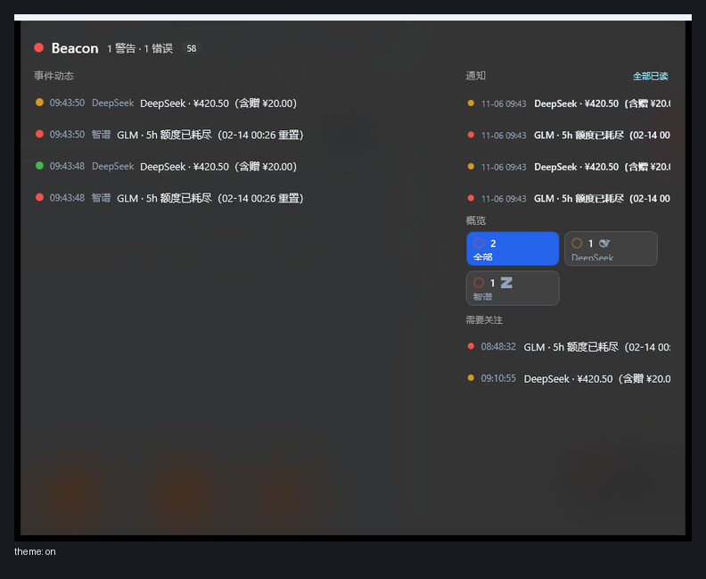
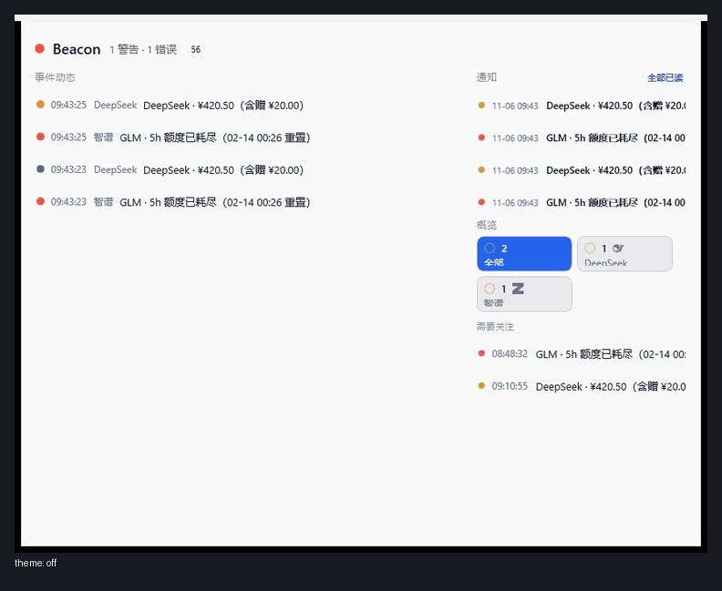

## pinDisplayMode — one host panel vs one window per widget


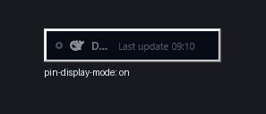
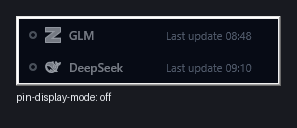

## appearance.progressStyle — bar vs pool


## appearance.motion.mode — off vs full

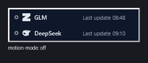


## appearance.density — regular vs spacious

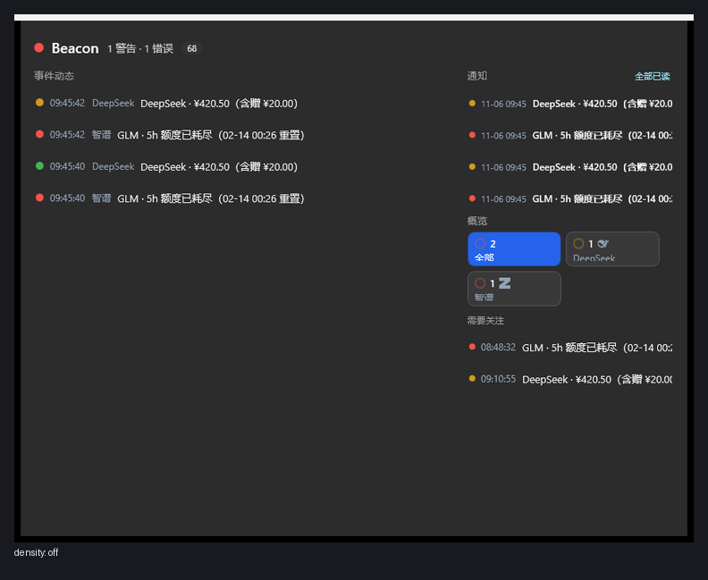
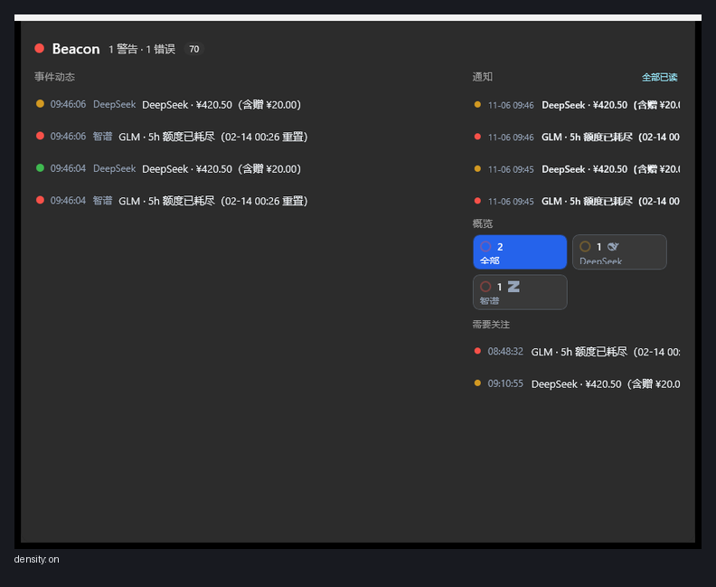


## appearance.severityColors.warning — default amber vs custom


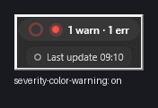


## uiOpacity — opaque vs 50 %

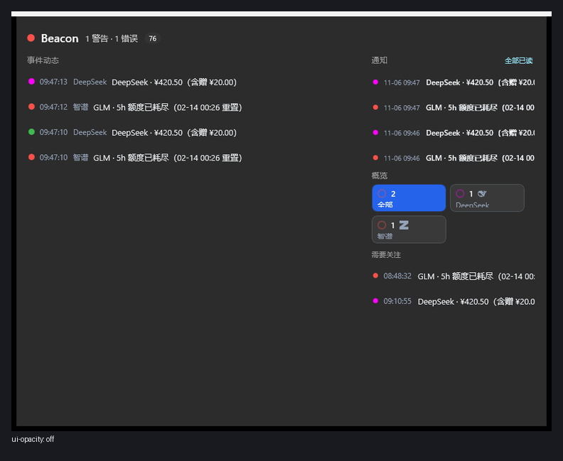
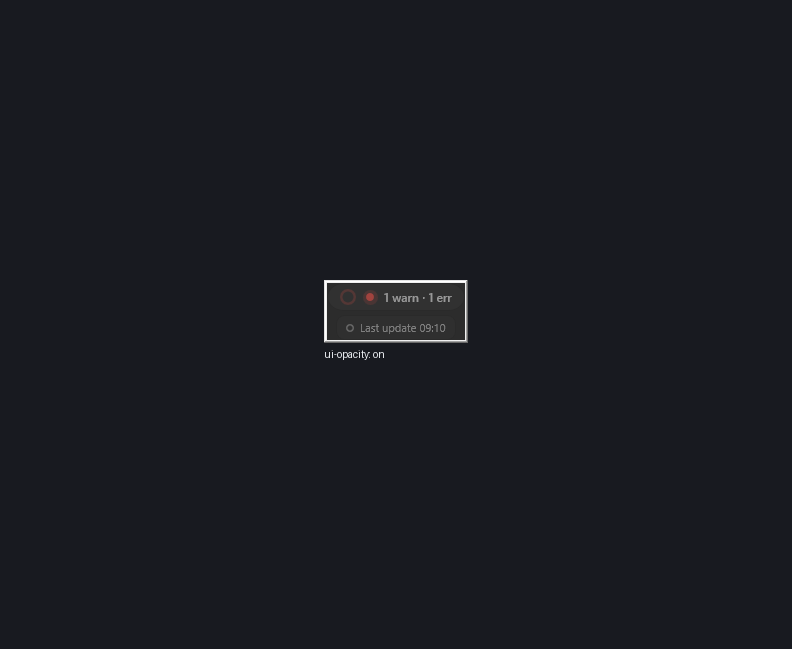
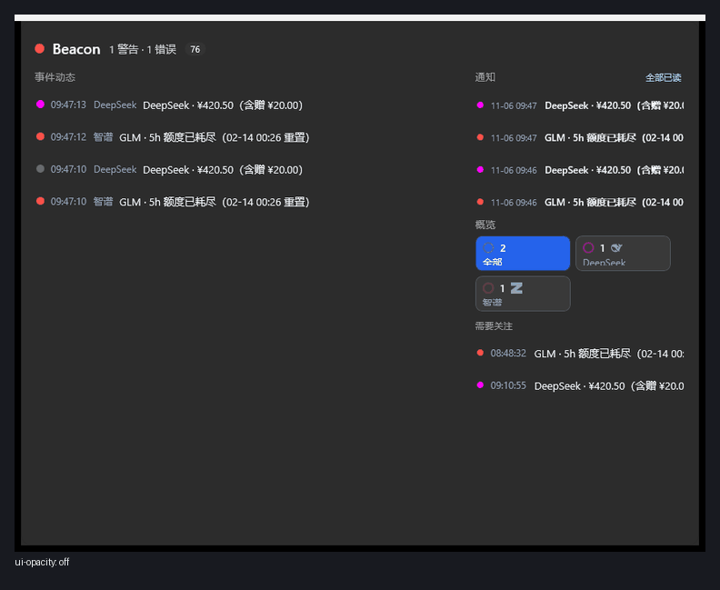

## capsuleIsland — capsule vs island

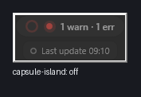
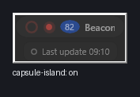


## widgets.json colorOverride — palette vs widget colour

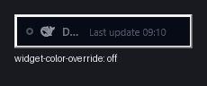


---

*Captured 2026-11-06 on the real Windows 11 verification box against build
`2026.11.6+56e4f277835116584b26c0766806712ed740ea53`; frames and manifest in
`docs/img/config-effects-src/`. 中文版：[配置效果（开/关对照）](zh/configuration-effects.md).*
