# 配置效果（开 / 关对照）

下面每个开关/配置项都是「开启后才有效果」——本页给出它开与关的真实对照图：静帧成对 + 切换动图，全部在真机 Windows 上截取（非手绘、非示意图）。

**图片怎么来的**（可重跑流水线，`kode todo C-24` 同款）：

```bash
# 1. Windows 上：改 config.json/widgets.json → 重启构建 → PrintWindow 截各表面
powershell -NoProfile -ExecutionPolicy Bypass -File tools/doc-gif/capture-config-effects.ps1 `
    -Publish <path\to\Beacon.App.exe> -OutDir <frames-dir>
# 2. 任意机器：合成 GIF 与静帧
python tools/doc-gif/assemble.py <frames-dir> docs/img/config-effects
```

截图为**窗口级**（`PrintWindow(PW_RENDERFULLCONTENT)`）：截的是窗口自身的实时内容，因此流水线不依赖控制台当前是锁屏、在别的虚拟桌面还是屏保，随时可重跑。

## 开关一览

| 键 | 位置 | 关 | 开 | 生效时机 |
|---|---|---|---|---|
| `theme` | config.json → `theme` | `light` | `dark` | 重启（WinUI 主题只在进程启动时可设） |
| `pinDisplayMode` | config.json → `pinDisplayMode` | `panel`（L0 单宿主窗） | `floating`（每组件一窗） | 重启 |
| `appearance.progressStyle` | config.json → `appearance` | `pool`（旧版圆环水位） | `bar`（4 DIP 条 + NN% 读数） | 即时 |
| `appearance.motion.mode` | config.json → `appearance.motion` | `off`（全静止） | `full`（呼吸/脉冲常驻） | 即时 |
| `appearance.density` | config.json → `appearance` | `regular` | `spacious`（间距 ×1.25） | 各表面下次渲染 |
| `appearance.severityColors.warning` | config.json → `appearance` | `#d29922`（默认琥珀） | `#ff00ff`（自定义） | 即时——托盘/胶囊/L0 同步跟随 |
| `uiOpacity` | config.json | `1.0` | `0.5` | 即时 |
| `capsuleIsland` | config.json | `false`（胶囊贴右下） | `true`（悬浮岛贴顶部居中） | 即时 |
| `colorOverride`（组件级） | widgets.json | 缺省（跟随调色板） | `#00e5ff`（组件色优先于调色板） | 即时 |

> `launchOnStartup`、`hotkey`、`pollIntervalSeconds`、`keepQuickPanelOpen`、`edgeCollapseEnabled`
> 这几项没有「值得拍照」的画面——它们的效果是注册表值、注册的热键、刷新节奏或运行期行为，
> 证据见 [`docs/acceptance-evidence/`](../acceptance-evidence/2026-11-06-realmachine.md)。

## theme —— 浅色 / 深色


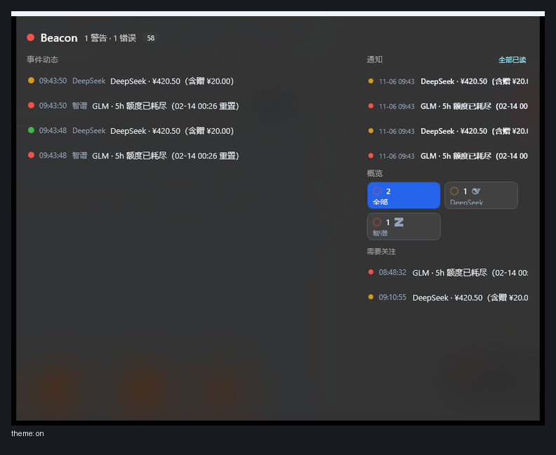
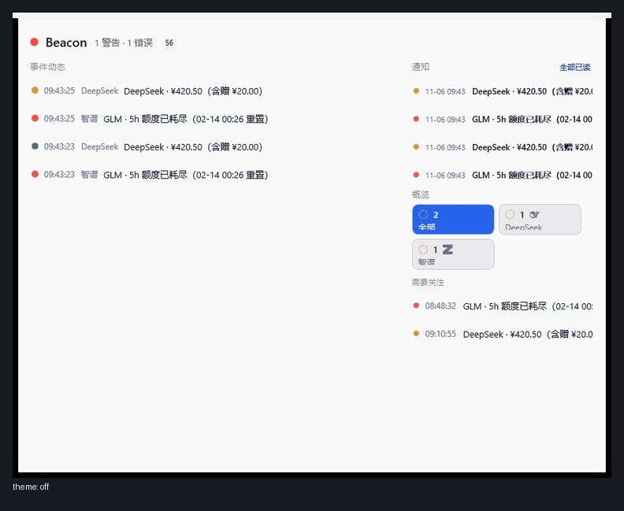

## pinDisplayMode —— 单宿主面板 / 每组件一窗


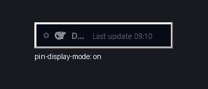
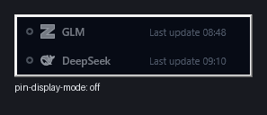

## appearance.progressStyle —— 条形 / 圆环水位


## appearance.motion.mode —— 静止 / full

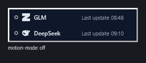


## appearance.density —— regular / spacious

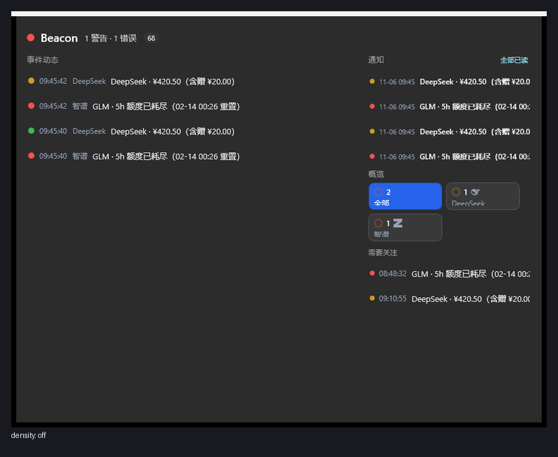
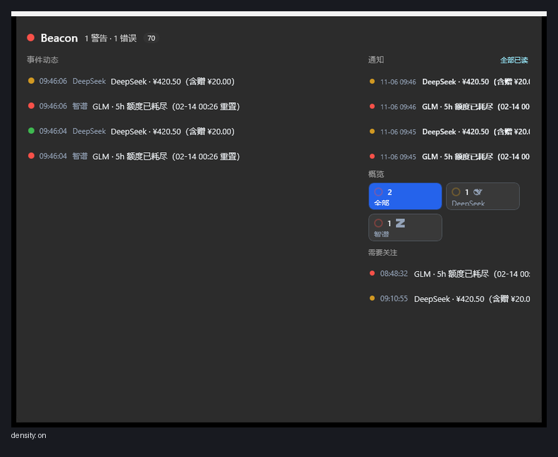


## appearance.severityColors.warning —— 默认琥珀 / 自定义


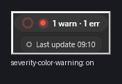


## uiOpacity —— 不透明 / 50%

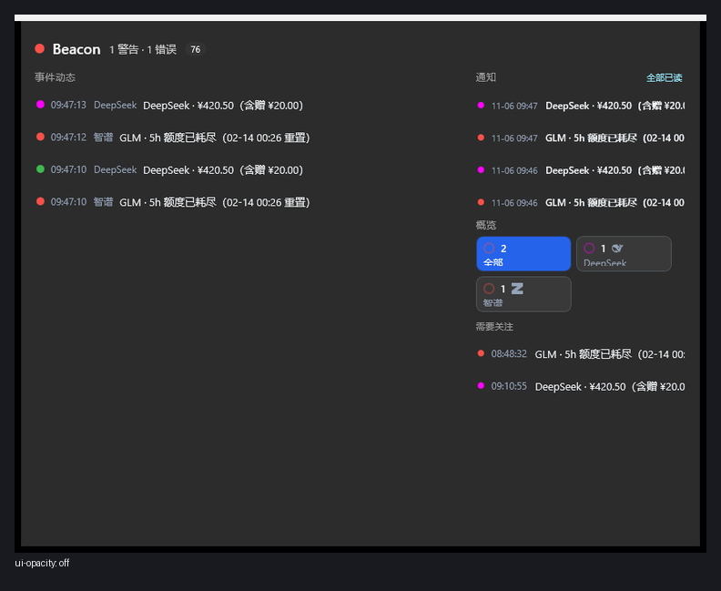
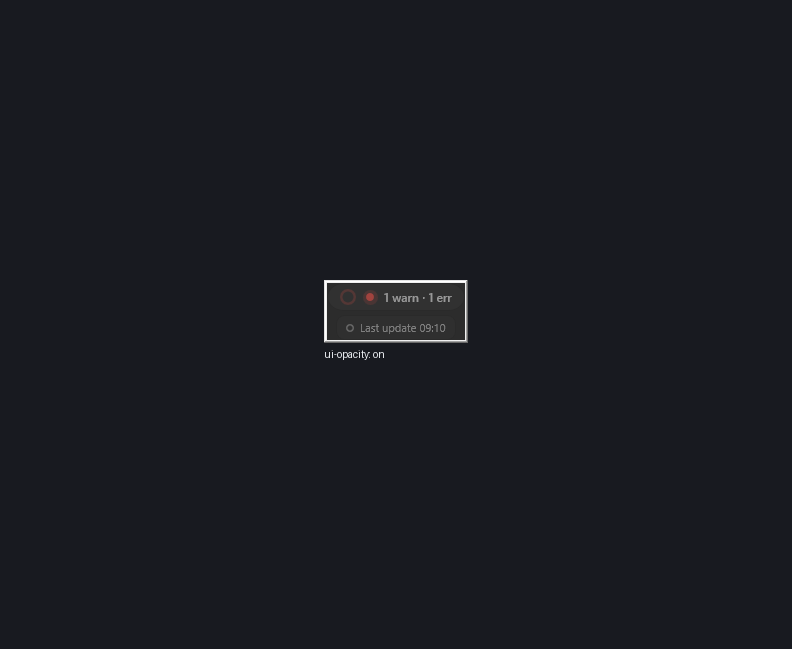
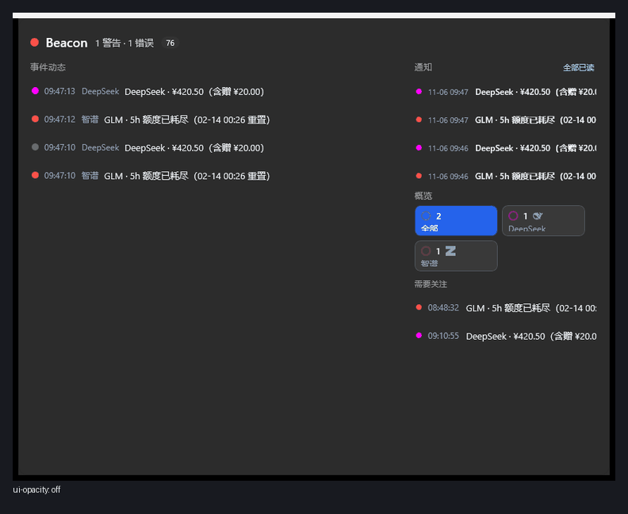

## capsuleIsland —— 胶囊 / 悬浮岛

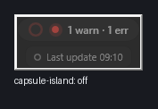
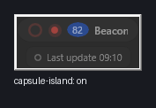


## widgets.json colorOverride —— 跟随调色板 / 组件专属色

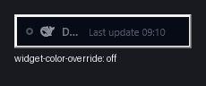


---

*2026-11-06 于真机 Windows 11 验证机截取，构建 `2026.11.6+56e4f277835116584b26c0766806712ed740ea53`；
帧与清单见 `docs/img/config-effects-src/`。English: [Configuration effects (off / on)](../configuration-effects.md).*
